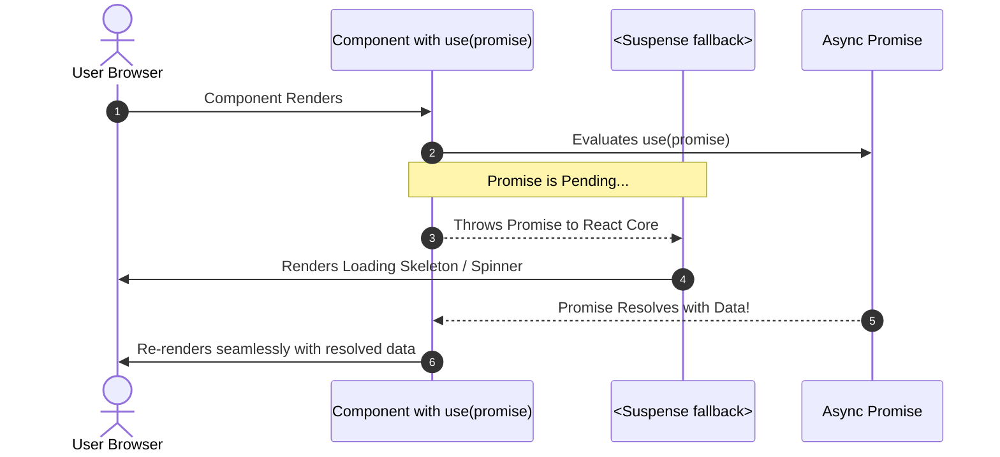

# Mastering React 19's `use()` Hook: Unlocking First-Class Async & Promise Handling

Since the introduction of Hooks in React 16.8, one cardinal rule was drilled into every frontend engineer's brain: **"Never call hooks inside loops, conditions, or nested functions."**

React 19 radically upends this dogma with the introduction of the **`use()` API**. Not only does `use()` permit conditional invocation, but it also provides a first-class bridge between asynchronous data (Promises) and the component rendering cycle.

Let's dive into how `use()` works, why it eliminates mountains of boilerplate, and how to harness its power in your next application.

---

## 1. What Makes `use()` Fundamentally Different?

Unlike `useState`, `useEffect`, or `useMemo`, `use()` is technically not a conventional Hook—it is an **imperative reader function**:

1. **It can be called conditionally:** You can safely wrap `use()` inside `if` statements, ternary operators, or switch statements.
2. **It unwraps Promises directly in render:** Instead of maintaining `isLoading`, `error`, and `data` state variables inside `useEffect`, `use(promise)` suspends the component until the Promise settles!
3. **It replaces `useContext()`:** You can read React Context dynamically and conditionally.



---

## 2. Promise Resolution: Before vs. After

### ❌ The Legacy Way (React 18 Boilerplate):
Notice the verbose state synchronization, loading flags, and `useEffect` dependency arrays:

```tsx
// Legacy React 18
function UserProfile({ userId }: { userId: string }) {
  const [user, setUser] = useState<User | null>(null);
  const [loading, setLoading] = useState(true);
  const [error, setError] = useState<Error | null>(null);

  useEffect(() => {
    let cancelled = false;
    setLoading(true);
    fetchUser(userId)
      .then((data) => {
        if (!cancelled) setUser(data);
      })
      .catch((err) => {
        if (!cancelled) setError(err);
      })
      .finally(() => {
        if (!cancelled) setLoading(false);
      });

    return () => { cancelled = true; };
  }, [userId]);

  if (loading) return <SkeletonLoader />;
  if (error) return <ErrorMessage error={error} />;
  return <div>Welcome back, {user?.name}!</div>;
}
```

---

### ✅ The Modern React 19 Way with `use()`:
Zero state variables, zero `useEffect`, and zero cancellation flags. React handles the pending state via `<Suspense>` and errors via `<ErrorBoundary>`:

```tsx
// Modern React 19
import { use, Suspense } from "react";

// Client Component unwraps the Promise
function UserProfileContent({ userPromise }: { userPromise: Promise<User> }) {
  // use() suspends until the promise resolves!
  const user = use(userPromise);

  return (
    <div className="p-6 rounded-2xl bg-card border shadow-lg">
      <h2 className="text-xl font-bold text-foreground">Welcome, {user.name}!</h2>
      <p className="text-sm text-muted-foreground">{user.email}</p>
    </div>
  );
}

// Parent Component initiates the request and provides Suspense fallback
export function UserProfile({ userId }: { userId: string }) {
  // Start fetching WITHOUT blocking the parent component!
  const userPromise = fetchUser(userId);

  return (
    <Suspense fallback={<div className="h-28 w-full animate-pulse bg-muted rounded-2xl" />}>
      <UserProfileContent userPromise={userPromise} />
    </Suspense>
  );
}
```

---

## 3. Conditional Context Reading

Previously, if you wanted to read Context, you had to invoke `useContext()` at the root level of your component, even if the value was only needed under rare circumstances. With React 19's `use()`, you can read Context strictly when needed:

```tsx
import { use } from "react";
import { ThemeContext, AnalyticsContext } from "@/contexts";

export function NavigationBar({ enableAnalytics }: { enableAnalytics: boolean }) {
  // Unconditional Context read
  const theme = use(ThemeContext);

  // ✅ VALID IN REACT 19: Conditional Context read!
  if (enableAnalytics) {
    const analytics = use(AnalyticsContext);
    analytics.trackView("Navbar");
  }

  return (
    <header className={theme === "dark" ? "bg-zinc-950 text-white" : "bg-white text-zinc-900"}>
      <nav>Portfolio Navigation</nav>
    </header>
  );
}
```

---

## 4. Key Rules to Remember

1. **Promises Must Be Cached or Created in Server Components:**  
   Do *not* create a new Promise directly inside a client component's render body (e.g. `use(fetch(...))` without caching), as this will trigger an infinite fetch loop on every render! Instead, pass the Promise from a Server Component or cache it with a library / `useMemo`.
2. **Pairs Naturally with React Server Components (RSC):**  
   Server Components initiate data fetching on the server, stream the unresolved Promise over the wire to Client Components, and client components unwrap it with `use()`.
3. **No `async/await` in Client Components:**  
   Client components cannot be `async` functions. `use()` is React's official solution for consuming async data inside client-rendered components.

React 19's `use()` hook represents a monumental shift toward declarative, fluid async UI architectures, making complex streaming interfaces feel intuitive and effortless.
