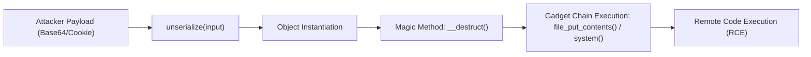

# Demystifying Modern PHP Vulnerabilities: From Type Juggling to Insecure Deserialization

Despite the rapid proliferation of modern runtimes, PHP remains the silent engine powering nearly **76% of all CMS and web applications globally**. However, its forgiving history, dynamic typing heritage, and backwards-compatibility compromises create a unique threat landscape for developers who rely on outdated conventions.

In this deep-dive, we examine the most prevalent PHP vulnerabilities found in enterprise audits today, demonstrate the mechanics of real-world exploit chains, and architect robust defense strategies using **PHP 8.3+ and modern security primitives**.

---

## 1. The Magic Hash & Type Juggling Trap

PHP's loose comparison operator (`==`) performs implicit type coercion. When comparing strings that appear to be scientific notation (beginning with `0e` followed entirely by numbers), PHP casts both operands to float `0`.

```php
// The Magic Hash Flaw
$hashA = "0e123456789012345678901234567890";
$hashB = "0e987654321098765432109876543210";

var_dump($hashA == $hashB); // Returns TRUE! (0 * 10^1234... == 0 * 10^9876...)
```

### The Attack Vector: Authentication Bypass
If an administrative login script compares password hashes using loose comparison:

```php
// ❌ VULNERABLE: Loose comparison authentication
if (md5($userProvidedPassword) == $storedAdminPasswordHash) {
    $_SESSION['admin'] = true;
}
```

An attacker can generate or brute-force a payload whose MD5 begins with `0e` and consists solely of digits (such as `240610708` whose MD5 is `0e462097431906509019562988736854`). If the stored hash is also a magic hash, authentication succeeds without knowing the real credentials!

### The Modern Fix:
Always declare strict types and utilize timing-attack resistant comparisons or modern hashing algorithms:

```php
// ✅ SECURE: Constant-time comparison & password_verify()
declare(strict_types=1);

if (hash_equals($storedHash, hash('sha256', $password))) {
    // Constant-time hash check
}

// Or preferably native bcrypt/Argon2id:
if (password_verify($password, $user['password_hash'])) {
    // Fully protected against type coercion and timing attacks
}
```

---

## 2. Insecure Deserialization & POP Gadget Chains

PHP's native serialization format transforms objects into string representations. When `unserialize()` processes user-controlled data, it instantiates objects and automatically invokes magic lifecycle hooks:
* `__wakeup()` (upon deserialization)
* `__destruct()` (upon object destruction/script termination)
* `__toString()` (when treated as string)



### Vulnerable Implementation Example:
Imagine a logging class inside a vendor library:

```php
class TemporaryFileLogger {
    public string $filePath;
    public string $content;

    public function __destruct() {
        // Automatically writes log on destruction
        file_put_contents($this->filePath, $this->content);
    }
}

// In your application controller:
$userData = unserialize($_COOKIE['user_session']); // ❌ CRITICAL RCE!
```

An attacker can forge a serialized payload targeting `TemporaryFileLogger`, setting `$filePath = "/var/www/html/shell.php"` and `$content = "<?php system($_GET['cmd']); ?>"`. When the PHP script ends, the destructor executes and drops a web shell on the server!

### The Modern Fix:
1. **Never use `unserialize()` on untrusted inputs.** Transition to JSON serialization:
   ```php
   $data = json_decode($cookie, true, 512, JSON_THROW_ON_ERROR);
   ```
2. If legacy code requires serialization, strictly disable class instantiation:
   ```php
   $safe = unserialize($payload, ['allowed_classes' => false]);
   ```

---

## 3. Server-Side Request Forgery (SSRF) via cURL & Wrappers

Modern microservices often fetch webhooks, open-graph image previews, or external APIs on behalf of users. When an application fetches a user-submitted URL without rigorous IP parsing, attackers target internal cloud infrastructure:

* AWS / GCP Instance Metadata: `http://169.254.169.254/latest/meta-data/`
* Internal Redis / Memcached / DB clusters: `http://127.0.0.1:6379/` or `http://0.0.0.0:8080/`
* Encapsulated protocol wrappers: `dict://`, `gopher://`, `file://`

### Hardening HTTP Clients against SSRF:

```php
function fetchSafeExternalUrl(string $url): string {
    $parsed = parse_url($url);
    if (!isset($parsed['host']) || !in_array($parsed['scheme'] ?? '', ['http', 'https'], true)) {
        throw new InvalidArgumentException("Invalid protocol or URL");
    }

    $ip = gethostbyname($parsed['host']);

    // Block private, loopback, and reserved IP ranges (RFC 1918 & Cloud Metadata)
    if (!filter_var($ip, FILTER_VALIDATE_IP, FILTER_FLAG_NO_PRIV_RANGE | FILTER_FLAG_NO_RES_RANGE)) {
        throw new SecurityException("Access to internal networks is forbidden!");
    }

    $ch = curl_init($url);
    curl_setopt_array($ch, [
        CURLOPT_RETURNTRANSFER => true,
        CURLOPT_FOLLOWLOCATION => false, // Prevent open redirects to internal targets
        CURLOPT_PROTOCOLS => CURLPROTO_HTTP | CURLPROTO_HTTPS, // Disable file:// & gopher://
        CURLOPT_TIMEOUT => 5,
    ]);
    
    $response = curl_exec($ch);
    curl_close($ch);
    return $response;
}
```

---

## 4. The 2026 PHP Hardening Checklist

| Security Control | Implementation Standard | Priority |
| :--- | :--- | :--- |
| **Strict Type Checking** | `declare(strict_types=1);` at the top of every PHP file. | Critical |
| **Prepared Statements** | Always use PDO parameterized queries with `PDO::ATTR_EMULATE_PREPARES => false`. | Critical |
| **php.ini Hardening** | `disable_functions = exec,system,passthru,shell_exec,proc_open,popen` | High |
| **Session Security** | `session.cookie_httponly = 1`, `session.cookie_secure = 1`, `session.cookie_samesite = Strict` | High |
| **File Upload Storage** | Store uploads outside web root (`/storage`) or on S3/Cloudflare R2; never trust `$_FILES['type']`. | High |
| **Error Handling** | `display_errors = Off`, log errors to centralized monitoring without leaking stack traces. | Medium |

Modern PHP 8.x is fast, expressive, and secure when built with intention. By eliminating legacy antipatterns and enforcing strict type boundaries, your backend will withstand even the most sophisticated automated exploit scans.
