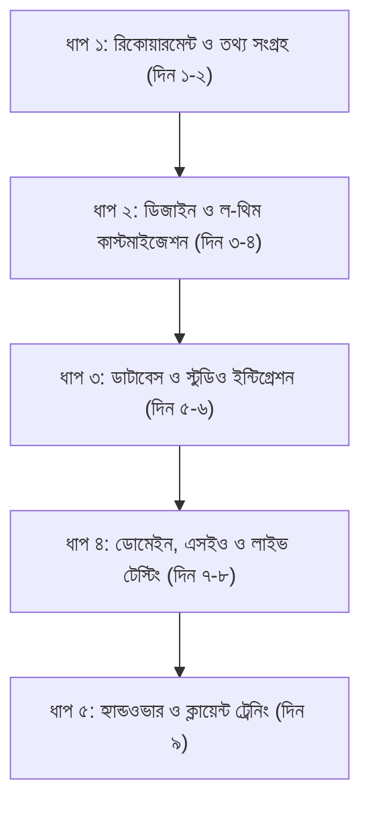

# ⚖️ লিগ্যাল / ল-প্রফেশনাল ফুলস্ট্যাক ওয়েব পোর্টফোলিও প্রপোজাল ও প্রজেক্ট গাইড

> **ডকুমেন্ট টাইপ:** ক্লায়েন্ট প্রজেক্ট প্রপোজাল, ফিচার স্পেসিফিকেশন ও প্রাইসিং গাইডলাইন  
> **টার্গেট ক্লায়েন্ট:** আইনজীবী / এডভোকেট / ব্যারিস্টার / লিগ্যাল কনসালটেন্ট / ল চেম্বার  
> **প্রস্তুতকারক:** ফুলস্ট্যাক ওয়েব ডেভেলপার  

---

## 📌 ১. প্রজেক্ট পরিচিতি (Executive Summary)

আইন পেশা (Legal Profession) মূলত **বিশ্বাসযোগ্যতা (Credibility), পেশাদারিত্ব (Professionalism) এবং সুনামের (Reputation)** ওপর প্রতিষ্ঠিত। বর্তমান ডিজিটাল যুগে উচ্চ আদালতের আইনজীবী, ব্যারিস্টার কিংবা জেলা জজ কোর্টের সিনিয়র আইনজীবীদের জন্য একটি আধুনিক, দৃষ্টিনন্দন ও তথ্যবহুল ফুলস্ট্যাক ওয়েব পোর্টফোলিও থাকা অত্যন্ত জরুরি। 

এই পোর্টফোলিওটি ক্লায়েন্টের জন্য কেবল একটি সাধারণ ওয়েবসাইট হবে না; এটি হবে তার **ডিজিটাল চেম্বার (Digital Chamber)**—যেখান থেকে নতুন ক্লায়েন্টরা তার অভিজ্ঞতা জানতে পারবে, আইনি পরামর্শের জন্য অ্যাপয়েন্টমেন্ট নিতে পারবে, সরাসরি ডকুমেন্ট পাঠাতে পারবে এবং আইনজীবী নিজেই কোনো ডেভেলপার ছাড়াই পুরো ওয়েবসাইটের কনটেন্ট ম্যানেজ করতে পারবেন।

---

## 🚀 ২. বিশেষায়িত লিগ্যাল ফিচারসমূহ (Features Checklist)

### ক. ক্লায়েন্ট-ফেসিং ফ্রন্টএন্ড (Public Portfolio Experience)
1. **প্রিমিয়াম হিরো সেকশন (Hero Section):**
   * আইনজীবীর প্রফেশনাল ছবি, পূর্ণ নাম, টাইটেল (যেমন: *Advocate, Supreme Court of Bangladesh* বা *Barrister-at-Law* / *Legal Consultant*)।
   * বার কাউন্সিল এনরোলমেন্ট নম্বর (Bar Council Reg No.), সদস্যপদ (SCBA / Bar Association) ব্যাজ।
   * সরাসরি "Book a Consultation" বা "আইনি পরামর্শ নিন" কল-টু-অ্যাকশন (CTA)।
2. **প্র্যাকটিস এরিয়া / আইনি সেবাসমূহ (Practice Areas):**
   * কোন কোন ক্ষেত্রে তিনি প্র্যাকটিস করেন (যেমন: *Criminal Defense, Civil Litigation, Corporate & Company Law, Family & Divorce Law, Land & Property Disputes, Cyber Crime, Banking & Cheque Dishonor Law (NI Act)*)।
   * প্রতিটি সেবার আওতায় কী ধরণের আইনি সহায়তা দেওয়া হয় তার সংক্ষিপ্ত বিবরণ।
3. **সফল কেস স্টাডিজ ও অভিজ্ঞতা (Notable Cases & Track Record):**
   * ক্লায়েন্টের নাম গোপন রেখে (Client Confidentiality বজায় রেখে) ঐতিহাসিক রায়, গুরুত্বপূর্ণ রিট পিটিশন, জামিন বা করপোরেট বিজয়ের সারসংক্ষেপ।
4. **শিক্ষাগত যোগ্যতা ও সনদ (Education & Credentials):**
   * LL.B (Hons), LL.M, Bar Vocational Course, আন্তর্জাতিক ডিপ্লোমা ও ট্রেনিং।
   * হাইকোর্ট ও জজ কোর্টের পারমিশন সংক্রান্ত তথ্য।
5. **অ্যাপয়েন্টমেন্ট ও আইনি পরামর্শ ফর্ম (Consultation Booking Form):**
   * সাধারণ যোগাযোগ ছাড়াও চেম্বারে সাক্ষাৎ বা অনলাইন কনসালটেশনের স্লট বুকিং।
   * প্রিলিমিনারি কেস বিবরণী এবং প্রয়োজনীয় কেস পেপারস/ডকুমেন্ট (FIR কপি, চুক্তিপত্র, নোটিশ) আপলোড করার সুবিধা।
   * ফর্ম সাবমিট হওয়ামাত্রই আইনজীবীর ইমেইল ও ফোনে ইনস্ট্যান্ট নোটিফিকেশন পৌঁছে যাওয়া।
6. **আইনি ব্লগ ও সচেতনতামূলক কলাম (Legal Blog & Articles):**
   * সাধারণ মানুষের জন্য আইনি সচেতনতা, সাম্প্রতিক আইন সংশোধন বা কলাম লেখার সেকশন। এটি গুগলে আইনজীবীর নাম ও ওয়েবসাইটকে এক নম্বরে র‍্যাংক করাতে সবচেয়ে বেশি সাহায্য করবে।
7. **ক্লায়েন্ট রিভিউ ও টেস্টিমোনিয়াল (Client Testimonials):**
   * পূর্ববর্তী করপোরেট ক্লায়েন্ট বা ব্যক্তিবিশেষের সন্তুষ্টির রিভিউ।
8. **ইন্টারঅ্যাক্টিভ লিগ্যাল এআই অ্যাসিস্ট্যান্ট (Legal Chatbot):**
   * সাইটে যুক্ত থাকা স্মার্ট চ্যাটবট ভিজিটরদের প্রাথমিক প্রশ্নের উত্তর দেবে (যেমন: চেম্বারের সময়সূচী, ফি কাঠামো, প্রয়োজনীয় ডকুমেন্ট লিস্ট) এবং তাদের কনসালটেশন বুক করতে উৎসাহিত করবে।
9. **রয়্যাল লিগ্যাল ডার্ক ও লাইট থিম (Adaptive Theme):**
   * আইন পেশার সাথে মানানসই রয়্যাল নেভি ব্লু/চারকোল ও গোল্ডেন এক্সেন্টযুক্ত ডার্ক থিম এবং মার্জিত ক্লিন লাইট মোড।

---

### খ. অ্যাডমিন স্টুডিও / ব্যাকএন্ড সিএমএস (Lawyer Admin Studio)
আইনজীবী বা তার চেম্বার অ্যাসিস্ট্যান্টের টেকনিক্যাল কোনো জ্ঞান ছাড়াই ওয়েবসাইট নিয়ন্ত্রণ করার পূর্ণ ব্যবস্থা:
1. **নো-কোড ড্যাশবোর্ড (Protected Admin Studio):**
   * সুরক্ষিত পাসওয়ার্ড/গুগল অথেন্টিকেশন দিয়ে লগইন।
2. **ডাইনামিক কনটেন্ট আপডেট:**
   * নতুন প্র্যাকটিস এরিয়া যুক্ত করা বা পরিবর্তন করা।
   * নতুন ব্লগ পোস্ট বা রায় যুক্ত করা।
   * ফি বা চেম্বার লোকেশন পরিবর্তন।
3. **কনসালটেশন ও মেসেজ ইনবক্স:**
   * ওয়েবসাইটে আসা ক্লায়েন্ট ইনকোয়ারি ও ডকুমেন্টস সরাসরি ড্যাশবোর্ড থেকে দেখা ও ডাউনলোড করা।
4. **মিডিয়া লাইব্রেরি:**
   * নতুন ছবি, মিডিয়া কভারেজ ও সার্টিফিকেট আপলোড সুবিধা।

---

## 🛠️ ৩. টেকনোলজি, ডাটাবেস ও হোস্টিং আর্কিটেকচার

এই প্রজেক্টের সবচেয়ে বড় সুবিধা হলো—**ক্লায়েন্টের প্রতি মাসে বা বছরে কোনো সার্ভার হোস্টিং খরচ লাগবে না!**

| কম্পোনেন্ট | প্রযুক্তি | কেন এটি সেরা? | ক্লায়েন্টের খরচ |
| :--- | :--- | :--- | :--- |
| **ফ্রন্টএন্ড ফ্রেমওয়ার্ক** | Next.js 16 (App Router) + React 19 | সুপারফাস্ট লোডিং স্পিড, আধুনিক ইউআই, অসাধারণ অ্যানিমেশন। | ফ্রি |
| **স্টাইলিং ও ডিজাইন** | Tailwind CSS + Lucide Icons | রেসপনসিভ (মোবাইল, ট্যাবলেট, ম্যাক, উইন্ডোজ সব ডিভাইসে পারফেক্ট)। | ফ্রি |
| **ডাটাবেস** | MongoDB Atlas (Cloud Cluster) | ক্লাউড ডেটাবেস, লাইফটাইম ফ্রি মায়লস্টোন (M0 Cluster), কোনো ডাউনটাইম নেই। | ৳০ (সম্পূর্ণ ফ্রি) |
| **হোস্টিং প্ল্যাটফর্ম** | Vercel (Hobby Platform) | গ্লোবাল এজ সিডিএন, অটোমেটিক এসএসএল (HTTPS Security), ১০০% আপটাইম। | ৳০ (সম্পূর্ণ ফ্রি) |
| **ফাইল/ডকুমেন্ট স্টোরেজ** | Uploadthing / Cloudinary | ক্লায়েন্টের কেস পেপারস ও ছবি নিরাপদে ক্লাউডে স্টোর করা। | ৳০ (ফ্রি টিয়ার যথেষ্ট) |
| **ইমেইল নোটিফিকেশন** | Resend / Nodemailer (SMTP) | ক্লায়েন্ট বুকিং দিলে আইনজীবীর পার্সোনাল ইমেইলে সাথে সাথে মেসেজ চলে যাবে। | ৳০ (ফ্রি) |

---

## 🌐 ৪. ডোমেইন নাম সাজেশন ও বাৎসরিক খরচ (Domain Suggestions)

আইন পেশার পোর্টফোলিওতে একটি ক্যাচি ও প্রফেশনাল ডোমেইন নাম থাকা জরুরি। ক্লায়েন্টের নাম যদি হয় **Advocate Sifat / Barrister Rahman**, তবে নিচের ফরম্যাটগুলো দারুণ মানাবে:

### ক. সাজেস্টেড ডোমেইন নামসমূহ:
1. `advocatesifat.com` (সবচেয়ে ক্লাসিক ও জনপ্রিয়)
2. `sifatlegal.com` (কর্পোরেট ও মডার্ন আইনি চেম্বারের জন্য)
3. `barristersifat.com` (ব্যারিস্টার হলে সবচেয়ে উপযোগী)
4. `sifatlawchamber.com` (চেম্বার বা অ্যাসোসিয়েটসের জন্য)
5. `sifatlaw.com.bd` (বাংলাদেশি ক্লায়েন্টদের কাছে সর্বোচ্চ গ্রহণযোগ্য)

### খ. ডোমেইন প্রাইসিং তালিকা (বাৎসরিক খরচ):

| ডোমেইন এক্সটেনশন | সুবিধা ও গ্রহণযোগ্যতা | বাৎসরিক খরচ (আনুমানিক) |
| :--- | :--- | :--- |
| **`.com`** | গ্লোবাল স্ট্যান্ডার্ড, বিশ্বজুড়ে বিশ্বস্ত ও সহজবোধ্য। | ৳১,৩৫০ - ৳১,৫৫০ / বছর |
| **`.com.bd`** | বিটিসিএল (BTCL) অনুমোদিত অফিসিয়াল বাংলাদেশি ডোমেইন (২ বছরের জন্য নিতে হয়)। | ৳১,৮০০ - ৳২,০০০ (২ বছরের জন্য) |
| **`.legal` / `.law`** | শুধুমাত্র লিগ্যাল প্রফেশনালদের জন্য স্পেশাল ডোমেইন। | ৳৩,৫০০ - ৳৫,৫০০ / বছর |
| **`.online` / `.pro`** | বাজেট-ফ্রেন্ডলি বিকল্প ডোমেইন। | ৳৫০০ - ৳৯৫০ / প্রথম বছর |

> **💡 রিকমেন্ডেশন:** ক্লায়েন্টকে সরাসরি **`.com`** ডোমেইন নেওয়ার পরামর্শ দিন। কারণ এটি সবচেয়ে সহজ এবং আইনজীবীর ভিজিটিং কার্ডে দেখতে সবচেয়ে সুন্দর লাগে।

---

## 💰 ৫. প্রাইসিং মডেল: ক্লায়েন্টের কাছ থেকে সর্বনিম্ন কত টাকা চাওয়া উচিত?

যেহেতু ওয়েবসাইটটিতে **Next.js 16, ক্লাউড ডাটাবেস, কাস্টম সিএমএস স্টুডিও, এআই চ্যাটবট, এবং এসইও (Google Knowledge Schema)** রয়েছে—এটি কোনো সাধারণ ওয়ার্ডপ্রেস সাইট নয়, এটি একটি পূর্ণাঙ্গ কাস্টম সফটওয়্যার সল্যুশন।

বাংলাদেশে একজন পেশাদার ফুলস্ট্যাক ডেভেলপার হিসেবে আপনার প্রাইসিং স্ট্রাকচার নিচে দেওয়া হলো:

### ক. সর্বনিম্ন বটম-লাইন প্রাইস (Floor Price)
> ⚠️ **সর্বনিম্ন অফার (Floor Price): ৳১৫,০০০ - ৳১৮,০০০ টাকা**  
> এর নিচে কখনোই এই ফুলস্ট্যাক পোর্টফোলিও অফার করবেন না। কারণ এতে সিএমএস, ডাটাবেস এবং ডোমেইন কনফিগারেশন জড়িত।

---

### খ. ক্লায়েন্টের সামনে পেশ করার মতো ৩টি প্যাকেজ (Tiered Packages)

#### 🥉 ১. বেসিক লিগ্যাল পোর্টফোলিও (Basic Edition)
* **টার্গেট:** নতুন প্র্যাকটিস শুরু করা জুনিয়র আইনজীবী বা বাজেট-সচেতন ক্লায়েন্ট।
* **ফিচার:**
  * ওয়ান-পেজ মডার্ন পোর্টফোলিও (Hero, Bio, Practice Areas, Credentials)।
  * কনসালটেশন কন্টাক্ট ফর্ম (ডাইরেক্ট ইমেইল অ্যালার্ট)।
  * মোবাইল ও ডেস্কটপ ১০০% রেসপনসিভ।
  * ১ বছরের জন্য ফ্রি ডোমেইন (.com) কানেকশন ও লাইফটাইম ফ্রি হোস্টিং।
* **প্রাইস:** **৳১৫,০০০ - ৳১৮,০০০ টাকা**

---

#### 🥈 ২. প্রফেশনাল ফুলস্ট্যাক ল-স্যুট (Professional Edition) — *Recommended*
* **টার্গেট:** সুপ্রিম কোর্ট বা জজ কোর্টের নিয়মিত প্র্যাকটিসিং আইনজীবী ও কনসালটেন্ট।
* **ফিচার:**
  * বেসিকের সব ফিচার অন্তর্ভুক্ত।
  * **সম্পূর্ণ নো-কোড অ্যাডমিন স্টুডিও (CMS Studio):** আইনজীবী নিজেই চেম্বার ফি, সেবা, ছবি আপডেট করতে পারবেন।
  * **ডকুমেন্ট আপলোডসহ অ্যাডভান্সড কনসালটেশন বুকিং সিস্টেম।**
  * **লিগ্যাল ব্লগ/আর্টিকেল মডিউল:** আইনি লেখালেখি পোস্ট করার সুবিধা।
  * **গুগল সার্চ ও লোকাল এসইও (SEO):** Google Search Console ভেরিফিকেশন, সitemap এবং Lawyer Schema.org ডেটা (গুগলে সার্চ দিলে সরাসরি চেম্বারের তথ্য দেখাবে)।
  * ডার্ক ও লাইট থিম সুইচিং।
* **প্রাইস:** **৳২৫,০০০ - ৳৩২,০০০ টাকা**

---

#### 🥇 ৩. এলিট চেম্বার ও ফার্ম এডিশন (Elite Law Chamber Edition)
* **টার্গেট:** প্রতিষ্ঠিত ল চেম্বার, একাধিক আইনজীবী পার্টনার বা সিনিয়র অ্যাডভোকেট।
* **ফিচার:**
  * প্রফেশনাল প্যাকেজের সব ফিচার অন্তর্ভুক্ত।
  * মাল্টি-লয়ার প্রোফাইল (চেম্বারের অন্যান্য অ্যাসোসিয়েট ও জুনিয়র আইনজীবীদের তালিকা)।
  * **ইন্টেলিজেন্ট লিগ্যাল এআই চ্যাটবট (AI Legal Assistant):** ক্লায়েন্টদের ২৪/৭ স্বয়ংক্রিয় প্রশ্নের উত্তর ও বুকিং সহায়তা।
  * কর্পোরেট ক্লায়েন্ট পোর্টাল ও কেস হিস্ট্রি ডিসপ্লে।
  * গুগল বিজনেস প্রোফাইল (Google Maps/Chamber) সেটআপ ও রিভিউ ইন্টিগ্রেশন।
  * ১ বছরের ফ্রি টেকনিক্যাল সাপোর্ট ও মেইনটেন্যান্স।
* **প্রাইস:** **৳৪৫,০০০ - ৳৬০,০০০ টাকা**

---

### গ. আপনার খরচ বনাম লাভ (Cost vs Profit Breakdown)

ধরা যাক আপনি **প্রফেশনাল প্যাকেজ (৳২৮,০০০)** এ ডিল ফাইনাল করলেন:
* **ডোমেইন খরচ (.com):** ~৳১,৪০০ টাকা
* **হোস্টিং খরচ (Vercel):** ৳০ টাকা (ফ্রি)
* **ডাটাবেস খরচ (MongoDB):** ৳০ টাকা (ফ্রি)
* **মোট ক্যাশ ইনভেস্টমেন্ট:** ~৳১,৪০০ টাকা
* **আপনার নেট প্রফিট (Net Profit):** **~৳২৬,৬০০ টাকা!**

---

## 📅 ৬. ওয়ার্কিং প্রসেস ও টাইমলাইন (Step-by-Step Delivery)

ক্লায়েন্টকে বোঝানোর জন্য একটি প্রফেশনাল ৭-১০ দিনের টাইমলাইন দিন:

1. **ধাপ ১: তথ্য ও ডকুমেন্ট সংগ্রহ (দিন ১-২)**
   * আইনজীবীর ভালো মানের ছবি, বায়োগ্রাফি, বার কাউন্সিল নম্বর, প্র্যাকটিস এরিয়ার তালিকা ও চেম্বারের ঠিকানা সংগ্রহ।
2. **ধাপ ২: কাস্টমাইজেশন ও ব্র্যান্ডিং (দিন ৩-৪)**
   * তার পছন্দের কালার স্কিম (রয়্যাল ব্লু, ডিপ নেভি, গোল্ডেন) অনুযায়ী কোডবেস সেটআপ।
3. **ধাপ ৩: ডাটাবেস ও স্টুডিও কনফিগারেশন (দিন ৫-৬)**
   * MongoDB Atlas ক্লাউড কানেক্ট করা এবং স্টুডিওতে টেস্ট ডেটা ইনপুট করা।
   * বুকিং ফর্মের সাথে তার ব্যক্তিগত ইমেইল কানেক্ট করা।
4. **ধাপ ৪: ডোমেইন ও এসইও সেটআপ (দিন ৭-৮)**
   * ডোমেইন কেনা ও Vercel DNS-এ লাইভ কানেক্ট করা।
   * Google Search Console-এ সাইট সাবমিট করা এবং সাইটম্যাপ ইনডেক্সিং শুরু করা।
5. **ধাপ ৫: ফাইনাল ডেলিভারি ও প্রশিক্ষণ (দিন ৯-১০)**
   * ক্লায়েন্টকে ড্যাশবোর্ডে লগইন করে কীভাবে নিজে লেখা বা কনটেন্ট এডিট করবেন তা একটি ছোট ৫ মিনিটের ভিডিও বা জুমে দেখিয়ে দেওয়া।

---

## 🎯 ৭. ক্লায়েন্টকে রাজি করানোর কৌশল (How to Pitch to a Lawyer)

আইনজীবীদের সাথে কথা বলার সময় টেকনিক্যাল কচকচানির চেয়ে **তাদের প্র্যাকটিসে এই সাইট কীভাবে নতুন ক্লায়েন্ট আনবে এবং সুনাম বাড়াবে**—সেটির ওপর জোর দিন:

1. **"স্যার, আপনার কোনো বাৎসরিক সার্ভার রেন্ট বা হোস্টিং ফি দেওয়া লাগবে না:"**  
   সাধারণ আইটি ফার্মগুলো প্রতি বছর ৫,০০০-১০,০০০ টাকা হোস্টিং ফি নেয়। তাদের বলবেন—*"আমি আপনার সাইটটি আধুনিক সিলিকন ভ্যালি ক্লাউড আর্কিটেকচারে বিল্ড করে দেবো, যার ফলে ডোমেইন রিনিউ ছাড়া আপনার কোনো সার্ভার বিল থাকবে না।"*
2. **"গুগলে আপনার নাম লিখে কেউ সার্চ দিলে সবার আগে আপনার চেম্বার শো করবে:"**  
   আইনজীবীদের সবচেয়ে বড় সমস্যা হলো ভূঁইফোড় ডিরেক্টরিতে তাদের ভুল তথ্য থাকে। নিজস্ব এসইও-ফ্রেন্ডলি সাইট থাকলে তারা গুগলে একক অথরিটি পাবে।
3. **"আপনার জুনিয়র বা আপনি নিজেই লেখালেখি ও কনসালটেশন আপডেট করতে পারবেন:"**  
   ছোটখাটো পরিবর্তনের জন্য প্রতিবার ডেভেলপারের কাছে ধর্ণা দিতে হবে না—কাস্টম স্টুডিও থেকেই মোবাইল দিয়ে চেঞ্জ করা যাবে।
4. **পেমেন্ট টার্মস (Payment Milestone):**
   * **৫০% অ্যাডভান্স (কাজের শুরুতে ডোমেইন ও সেটআপ বাবদ)**
   * **৩০% ডেমো দেখানোর পর (Vercel প্রিভিউ লিংকে সাইট দেখে সন্তুষ্ট হলে)**
   * **২০% ডোমেইন লাইভ ও স্টুডিও হ্যান্ডওভারের সময়**

---

> **সংকলন:** এই ডকুমেন্টে উল্লেখিত ফিচার ও কাঠামোটি আপনার বর্তমান পোর্টফোলিও কোডবেসের সাথে ১০০% সামঞ্জস্যপূর্ণ। খুব সামান্য কনটেন্ট পরিবর্তন করেই আপনি ক্লায়েন্টের জন্য এটি রেডি করে ফেলতে পারবেন।
